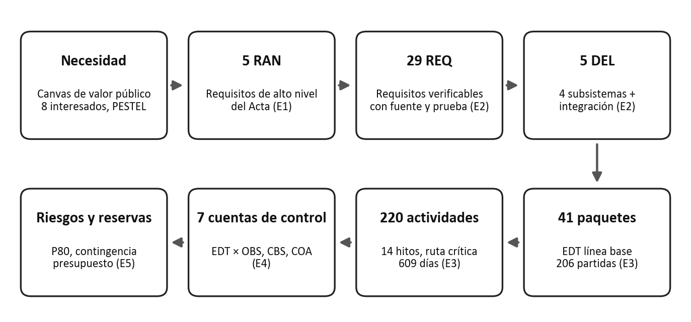

# Plan para la dirección del proyecto: Componente II de Seguridad Ciudadana de Virú

Proyecto final del curso IN4009 Gestión de Proyectos de Ingeniería (UTEC, ciclo 2026-2), Grupo 4.

El proyecto planifica el Componente II, Equipamiento Tecnológico, de la inversión «Mejoramiento del Servicio de Seguridad Ciudadana Local en la Ciudad de Virú» (CUI N.° 2639201): suministro, instalación e integración del equipamiento del COSC y de tres PAR, un sistema de videovigilancia de 99 cámaras, una red de 60.1 km de fibra óptica y un sistema de radiocomunicaciones digitales, con un costo directo de S/ 11,040,921.56.

El documento principal es el informe técnico final, que integra los cinco entregables del curso en un solo plan:

**[01_Plan_final/IN4009_Final_Grupo4_Plan.pdf](01_Plan_final/IN4009_Final_Grupo4_Plan.pdf)**

## Resultados principales

| Tema | Resultado |
| --- | --- |
| Requisitos | 5 requisitos de alto nivel y 29 requisitos verificables, con valor meta y método de prueba |
| Alcance | EDT de 11 entregables y 41 paquetes; las 206 partidas cierran con diferencia S/ 0.00 |
| Cronograma | La red corregida da la operatividad en 399 días (14/03/2028), no en los 240 de referencia; el proyecto completo dura 609 días |
| Costos | Estimado Clase 2, siete cuentas de control y código de imputación de cinco segmentos |
| Riesgos | Contingencia de S/ 495,153 al P80 (Monte Carlo de 1,000 futuros) y reserva de gestión de S/ 331,228 |
| Presupuesto propuesto | S/ 12,010,302 para el Componente II |

## Contenido del repositorio

| Carpeta | Contenido |
| --- | --- |
| `01_Plan_final` | Informe técnico final en PDF y Word |
| `02_Anexos_nativos` | Cronograma (MS Project XML), libro de costos, consolidación de costos, taller de riesgos con Monte Carlo, matriz de alcance y cronograma, bitácora de elección del PM |
| `03_Entregables` | Documentos entregados en cada etapa: E1 (Acta y plan), E2 (requisitos, alcance e interesados), E3 (plan, Gantt y evidencias DCMA) y la presentación de la sustentación |
| `04_Figuras` | Figuras principales del informe |

Los entregables E4 (costos) y E5 (riesgos) se entregaron como libros de Excel; están en `02_Anexos_nativos`.

## Cómo leer el proyecto

1. Empezar por el resumen ejecutivo y la Sección 4 del informe final, que explica por qué se eligió cada alternativa.
2. Para comprobar una cifra, abrir el archivo nativo que se indica en el Anexo F del informe.
3. El cronograma se abre en Microsoft Project desde el archivo `.xml` (Archivo, Abrir, tipo XML).

## Equipo

Gomez Pfuño, Jose; Ibañez Francisco, Gussephe Benjamin; Alegre Pajares, Esmeralda Xiomara. Docente: Legua Pérez, Carlos Rolando.

## Fuentes y uso de IA

Los datos provienen del expediente técnico aprobado del proyecto (CUI N.° 2639201), proporcionado por el docente; el expediente no se publica en este repositorio. El uso de inteligencia artificial como apoyo está declarado en el Anexo G del informe final.
